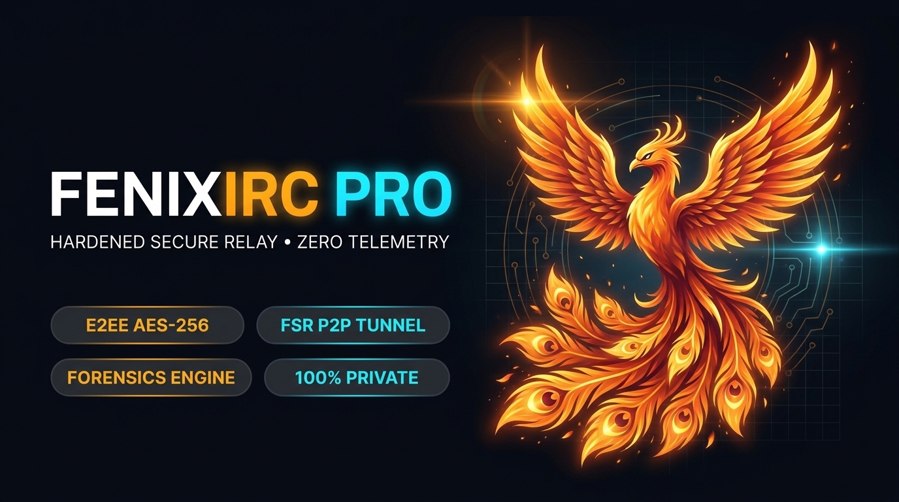
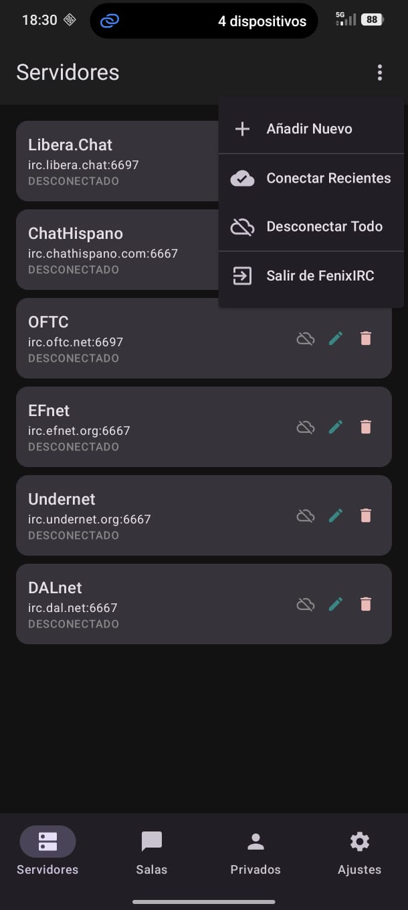
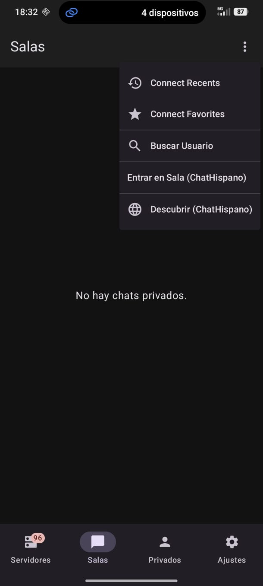
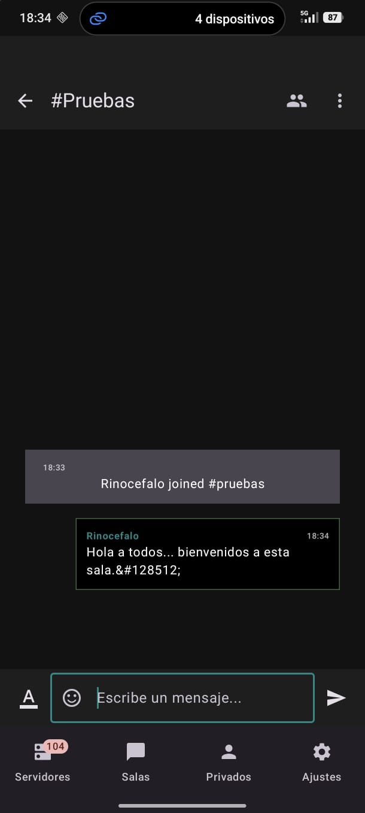
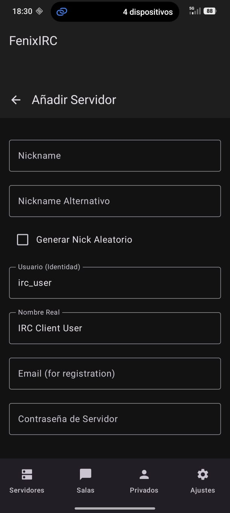
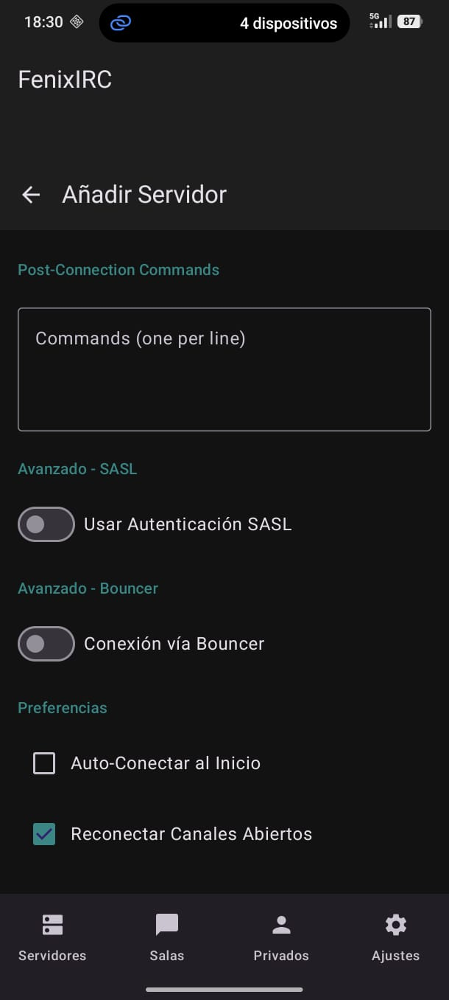
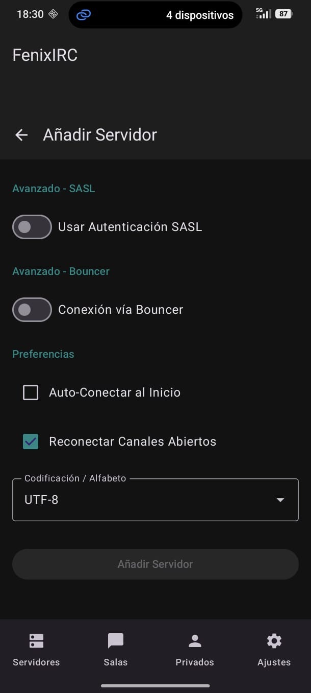

# FenixIRC

<p align="center">
  
</p>

<p align="center">
  
  
</p>

Modern Android IRC client built in Kotlin.

FenixIRC is an Android IRC client designed for secure communication, channel management, and flexible user customization. The project is built around a lightweight Lite version and a more complete Pro version, allowing users to choose the feature set they need while keeping the app maintainable and modular.

## Overview

FenixIRC aims to provide a practical IRC experience for Android with a focus on:

- reliable IRC communication
- user customization and interface flexibility
- native moderation tools
- script and bot support
- secure communication features in the Pro build
- open-source development with room for community contributions

## Features

### Core features

- Android IRC client built in Kotlin
- channel and private messaging support
- user and channel management tools
- moderation capabilities
- script support for automation and custom workflows
- bot integration support
- modern Android interface

### Lite / Pro model

- Lite build: essential IRC functionality for streamlined usage
- Pro build: expanded features for advanced users, including enhanced privacy and communication tools

### Security

- secure communication design for Pro functionality
- app-level configuration and privacy-aware architecture
- foundation for gradual security improvements

## Screenshots

<p align="center">
  
  
  
</p>

<p align="center">
  
  
  
</p>

## Project status

This project is in active development.

The repository currently contains the Android source code for the project, built with Android Studio and Gradle. It is intended for development, testing, and community-driven improvement.

## Requirements

- Android Studio
- Android SDK
- Kotlin toolchain
- Gradle

## Building the project

### Clone the repository

```bash
git clone https://github.com/drthands-apps/FenixIRC.git
cd FenixIRC
```

### Open in Android Studio

1. Open Android Studio
2. Select “Open an existing project”
3. Choose the cloned FenixIRC directory
4. Let Gradle sync
5. Build or run the app on a device or emulator

### Build from the command line

```bash
./gradlew assembleDebug
```

For a release build:

```bash
./gradlew assembleRelease
```

## Project structure

```text
FenixIRC/
├── app/
│   ├── src/
│   ├── build.gradle.kts
│   └── .gitignore
├── assets/
│   ├── fenixblue.png
│   ├── fenixorange.png
│   ├── fenixirczerotelemetry.png
│   └── screenshots and tutorial images
├── gradle/
├── build.gradle.kts
├── settings.gradle.kts
├── gradlew
├── gradlew.bat
├── LICENSE
├── README.md
├── .gitignore
└── ...
```

## Current application metadata

- Application package: `com.drthands.fenixirc`
- Minimum SDK: 24
- Target SDK: 37
- Version Code: 25
- Version Name: 0.99 rev4

## Development and contributions

Contributions are welcome.

If you want to improve the project, report bugs, propose features, or help with testing, feel free to open an issue or submit a pull request.

### Areas of contribution

- IRC protocol improvements
- UI and UX improvements
- moderation features
- security review
- scripting and bot support
- documentation and localization

## Community and contact

- Website: https://fenixirc.com
- Main site: https://drthands.com
- Email: contacto@drthands.com
- Email: drthands@gmail.com
- GitHub: https://github.com/drthands-apps

## Support and sponsorship

The project is maintained by the developer community and contributors. Support may come in the form of:

- code contributions
- bug reports
- feature suggestions
- testing and validation
- sponsorship or community support

## License

This project is licensed under the GNU General Public License v3.0. See the [LICENSE](LICENSE) file for the full text.

## Disclaimer

This project is provided as-is without warranty. Users are responsible for complying with local laws, IRC network rules, and the terms of the services they connect to.

---

FenixIRC is an open-source Android IRC client project intended for community-driven development and continuous improvement.
